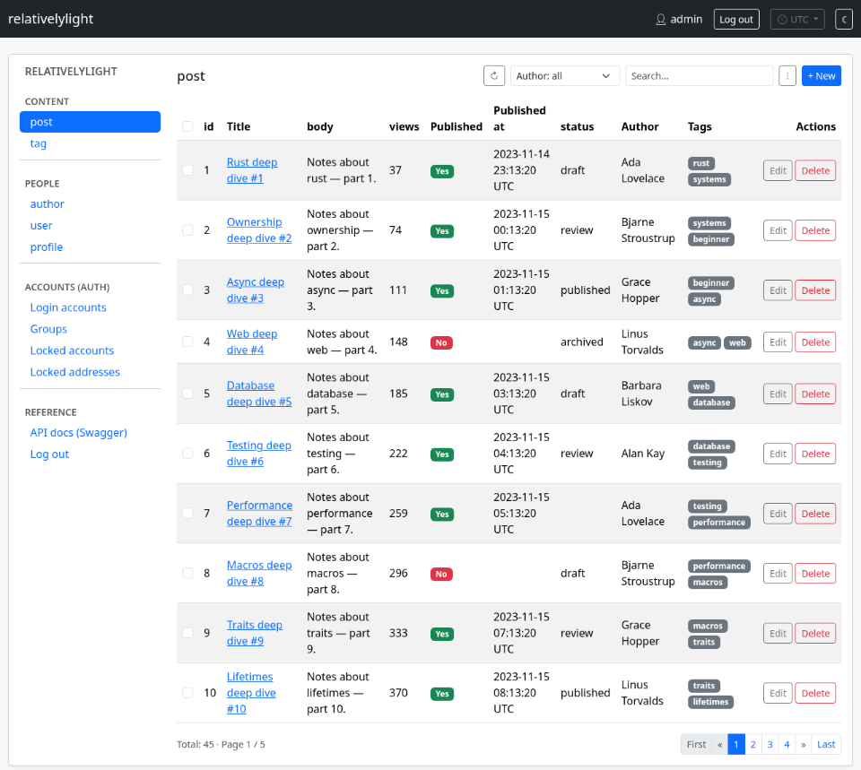
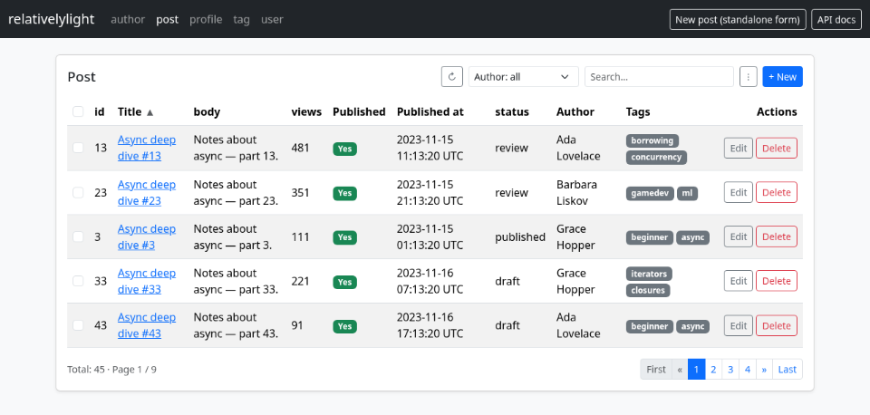
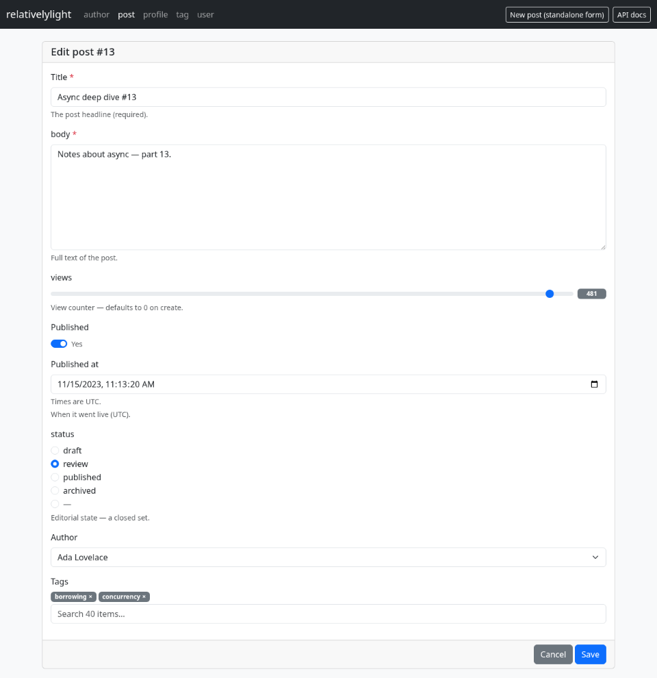
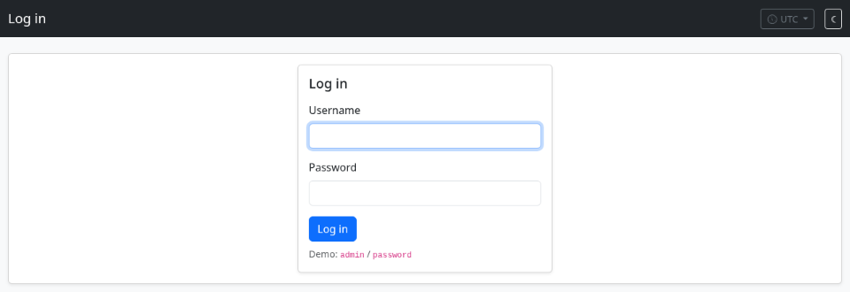
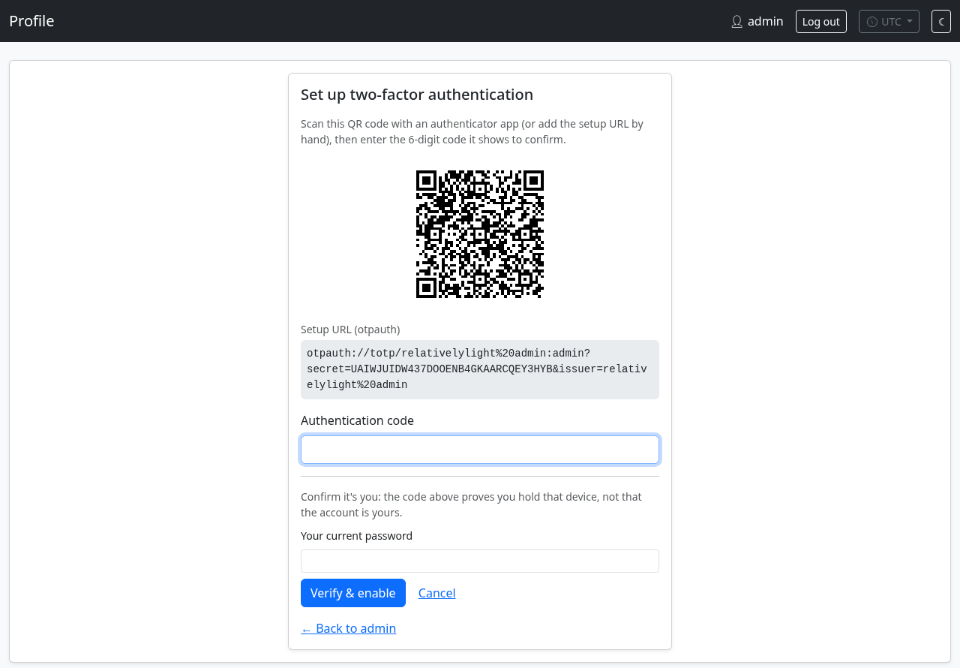

# relativelylight

A web back-office toolkit for Rust. **Auto-generate a server-rendered CRUD admin from your ORM
entities — with no per-model code**, gated by built-in authentication. It composes *into* your app:
you keep your own router and page shell; `relativelylight` contributes the HTML.

No JavaScript framework, no JSON API in between: the columns it introspects go straight into rendered
HTML, and writes come back as posted forms (`POST` → `303` → `GET`). Your page needs Bootstrap 5's
stylesheet, the crate's forty lines of CSS, and, for the relation picker, one small script.

## What it looks like

Nothing below is hand-written per model: the tables, the forms and their widgets are generated from
the entities, and the login / 2FA screens come with `auth`. Every shot is a runnable example —
`cargo run -p adminpanel-example` and `cargo run -p crud-example`.

[](docs/img/admin.png)

<sub>`crud::ui::Admin` — every registered model behind one side panel, login-gated
(`examples/adminpanel`).</sub>

<table>
<tr>
<td width="50%"><a href="docs/img/table.png"></a><br>
<sub><b>Table</b> — sortable headers, a filter on the <code>author</code> <i>relation</i>, search, bulk
actions, CSV, pager.</sub></td>
<td width="50%"><a href="docs/img/form.png"></a><br>
<sub><b>Form</b> — the same form the table opens in a dialog, standalone on your own page; widgets
picked per column type (or overridden).</sub></td>
</tr>
<tr>
<td width="50%"><a href="docs/img/login.png"></a><br>
<sub><b>Login</b> — an HTML fragment wrapped in <i>your</i> page shell; sessions, lockout and CSRF
included.</sub></td>
<td width="50%"><a href="docs/img/totp.png"></a><br>
<sub><b>TOTP 2FA</b> — self-service enrolment from <code>/profile</code>: QR + <code>otpauth://</code>
URL, verified (and re-authenticated) before it's on.</sub></td>
</tr>
</table>

## What you get

- **A web admin** (`crud::ui`): `Table` (sortable headers, filters, search, pager, bulk delete, CSV,
  a create/edit `<dialog>`), `Form` for your own pages, and `Admin` composing many tables behind one
  side panel. Every view is a URL.
- **A typed `Engine`** per entity — list/get/create/update/delete, relations by name, validation.
  Publish your own JSON API over it if you need one.
- **Auth** (`auth`): sessions, login, TOTP 2FA with recovery codes, lockout, CSRF, OIDC SSO, and a
  per-model gate.
- **File storage** (`blob`): content-addressed blobs under a stable handle with a version chain.
- **Timezones** (`tz`): integer-UTC storage, rendered server-side in the operator's zone.

## Quick start

```toml
[dependencies]
relativelylight = { version = "0.4", features = ["ui", "csv"] }
sea-orm = { version = "2.0", features = ["macros", "with-json"] }
```

```rust
use relativelylight::crud::seaorm::{Crud, MetaModel};
use relativelylight::crud::ui::{Admin, Outcome, ViewState};
use relativelylight::authz::Open;           // gate per model; Open = ungated

let author = MetaModel::new(author::Entity); // fields, keys and FK relations are introspected
let tag    = MetaModel::new(tag::Entity);
let mut post = MetaModel::new(post::Entity);
post.relate(&tag);                          // only N:M is declared by hand

let mut crud = Crud::new(db);
crud.register(author, Open);
crud.register(post, Open);
crud.register(tag, Open);
let engine = std::sync::Arc::new(crud.into_engine());
```

Then two handlers on a route of your own: a `get` that renders into your shell, a `post` that hands
the body back:

```rust
fn panel(engine: &Engine) -> Admin<'_> {
    Admin::new(engine).title("Admin").entities()
}

let app = axum::Router::new()
    .route("/admin", get(show).post(save))
    .with_state(engine)
    // Required and outermost: resolves the caller's address once (see docs/AUTH.md §4).
    .layer(axum::middleware::from_fn_with_state(
        relativelylight::middleware::TrustProxy(false),
        relativelylight::middleware::resolve_real_ip,
    ));

async fn show(headers: HeaderMap, uri: Uri, State(engine): State<Arc<Engine>>) -> Response {
    let state = ViewState::from_uri(&uri);
    match panel(&engine).render_for(&headers, &state).await {
        Ok(fragment) => Html(my_shell(fragment)).into_response(),
        Err(e) => e.into_response(),                        // 401/403 from the model's gate
    }
}

async fn save(headers: HeaderMap, uri: Uri, RealIp(ip): RealIp,
              State(engine): State<Arc<Engine>>, body: Bytes) -> Response {
    let state = ViewState::from_uri(&uri);
    match panel(&engine).submit(&headers, ip, &body, &state).await {
        Ok(Outcome::Done(to)) => Redirect::to(&to).into_response(),
        Ok(Outcome::Invalid(state)) => {                     // re-render with the messages in place
            let fragment = panel(&engine).render_for(&headers, &state).await.unwrap_or_default();
            (StatusCode::UNPROCESSABLE_ENTITY, Html(my_shell(fragment))).into_response()
        }
        Err(e) => e.into_response(),
    }
}
```

## Features

| Feature | Default | Adds |
|---|---|---|
| `crud` | ✅ | the CRUD engine + SeaORM backend |
| `axum` | ✅ | the request plumbing and the `middleware` module |
| `ui` | | `crud::ui`: `Table`, `Form`, `Admin`, `Picker`, `RelationField`; implies `axum` + `tz` |
| `csv` | | CSV import/export in the UI; implies `tz` |
| `tz` | | server-side timezone rendering (the `time` module) |
| `auth` | | sessions, login, TOTP 2FA, lockout, profile pages, gate presets |
| `csrf` | | the double-submit CSRF token; implied by `auth` |
| `sso` | | OIDC single sign-on + group mapping; implies `auth` |
| `blob` | | content-addressed file storage + version chain |
| `blob-ui` | | upload, viewer, document browser and admin panel for `blob`; implies `blob` + `ui` |

Registered entities need a **single-column primary key**, **single-column to-one FKs**, and
`Serialize`/`Deserialize` (SeaORM's `with-json`).

## Examples

All run on port 3000 over a seeded in-memory SQLite, so run one at a time:

```bash
cargo run -p crud-example            # Table/Form on your own pages, CSV, timezones, the relation picker
cargo run -p relationfield-example   # the admin's relation input in a hand-written form
cargo run -p adminpanel-example      # Admin behind login + 2FA (admin / password)
cargo run -p auth-example            # login, SSO wiring, 2FA, re-auth, the accounts panel (admin / password)
cargo run -p audit-example           # a request log and a write observer over one resolved address
cargo run -p blob-example            # file storage: uploads, viewer, browser, ownership (admin / password)
cargo run -p blobthumbnailer-example # derived content (thumbnails) written by the app
```

## Documentation

- **[docs/APP.md](docs/APP.md)** — start here: a whole app (shell, login, admin, your own pages).
- **[docs/CRUD.md](docs/CRUD.md)** — the `crud` engine and the web UI.
- **[docs/AUTH.md](docs/AUTH.md)** — sessions, login, 2FA, SSO, gates, CSRF.
- **[docs/TIME.md](docs/TIME.md)** — timestamps and timezones.
- **[docs/DATAINPUT.md](docs/DATAINPUT.md)** — the `validate` module.
- **[docs/BLOBSTORE.md](docs/BLOBSTORE.md)** — file storage.
- **[docs/MIGRATION-0.4.md](docs/MIGRATION-0.4.md)** — upgrading from 0.3.
- **[docs/PRD.md](docs/PRD.md)** and **[docs/TODO.md](docs/TODO.md)** — roadmap and backlog.
- **[CHANGELOG.md](CHANGELOG.md)** — per-release changes.
- **[CLAUDE.md](CLAUDE.md)** — working *on* the library.

## License

MIT © Tomas Hlavacek. See [LICENSE](LICENSE).
