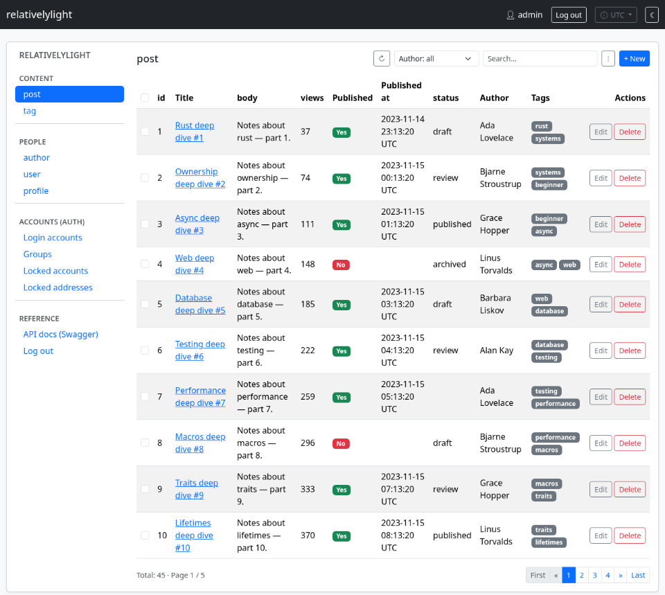
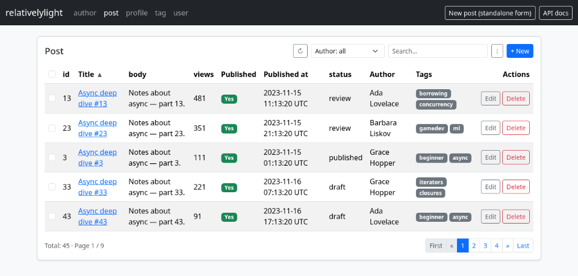
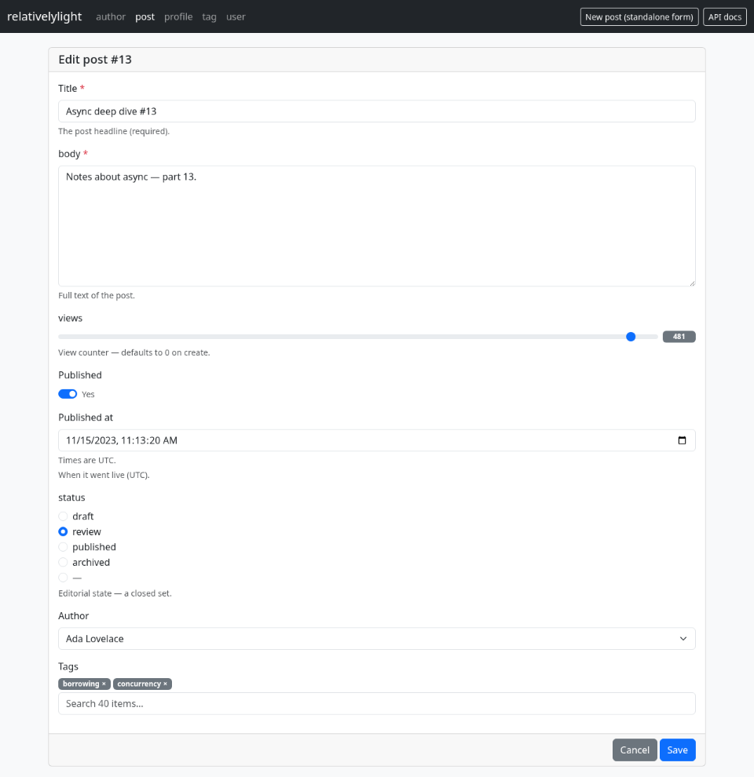
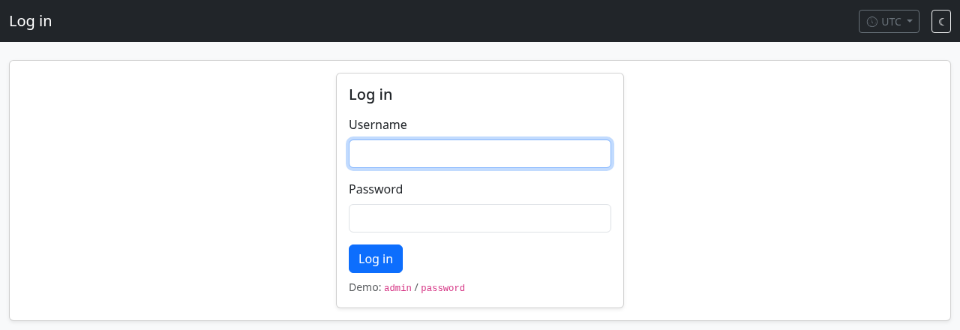
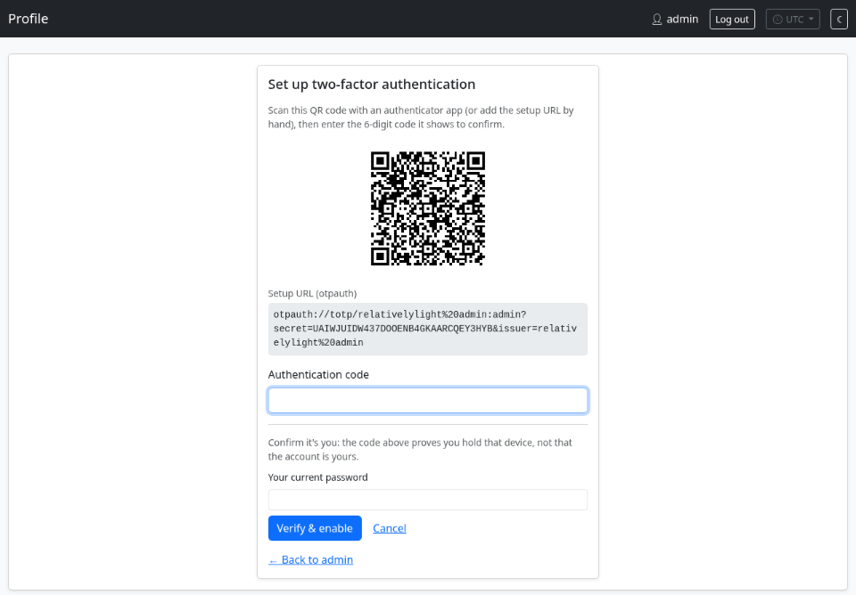

# relativelylight

A web back-office toolkit for Rust. **Auto-generate a server-rendered CRUD admin from your ORM
entities — with no per-model code**, gated by built-in authentication. It composes *into* your app:
you keep your own router and page shell; `relativelylight` contributes the HTML.

No JavaScript framework, no JSON API in between: the columns it introspects go straight into rendered
HTML, and writes come back as posted forms (`POST` → `303` → `GET`). Your page needs Bootstrap 5's
stylesheet, the crate's forty lines of CSS and one small script (modal dialogs, the relation picker;
everything works without it, only plainer).

## What it looks like

Nothing below is hand-written per model: the tables, the forms and their widgets are generated from
the entities, and the login / 2FA screens come with `auth`. Every shot is a runnable example —
`cargo run -p adminpanel-example` and `cargo run -p crud-example`.

[](docs/img/admin.png)

<sub>`crud::Admin` — every registered model behind one side panel, login-gated
(`examples/adminpanel`).</sub>

<table>
<tr>
<td width="50%"><a href="docs/img/table.png"></a><br>
<sub><b>Table</b> — sortable headers, a filter on the <code>author</code> <i>relation</i>, search, bulk
actions, CSV, pager.</sub></td>
<td width="50%"><a href="docs/img/form.png"></a><br>
<sub><b>Form</b> — the same form the table opens in a dialog, standalone on your own page; widgets
picked per column type (or overridden).</sub></td>
</tr>
<tr>
<td width="50%"><a href="docs/img/login.png"></a><br>
<sub><b>Login</b> — an HTML fragment wrapped in <i>your</i> page shell; sessions, lockout and CSRF
included.</sub></td>
<td width="50%"><a href="docs/img/totp.png"></a><br>
<sub><b>TOTP 2FA</b> — self-service enrolment from <code>/profile</code>: QR + <code>otpauth://</code>
URL, verified (and re-authenticated) before it's on.</sub></td>
</tr>
</table>

## What you get

- **A web admin** (`crud`): `Table` (sortable headers, filters, search, pager, bulk delete, CSV,
  a create/edit `<dialog>`), `Form` for your own pages, and `Admin` composing many tables behind one
  side panel. Every view is a URL. A relation field can create its missing row in a dialog
  (nesting), without losing the form, and a relation's label opens the linked row (and its edit
  form) in a dialog over the page.
- **A typed `Engine`** per entity — list/get/create/update/delete, relations by name, validation.
  Publish your own JSON API over it if you need one.
- **Auth**: sessions, login, TOTP 2FA with recovery codes, lockout, CSRF, OIDC SSO, API
  keys for machine endpoints (each acting as its owner, minted on `/profile`), passkeys (feature
  `passkeys`: sign-in without a password, a second factor, an app-wide hardware-binding policy), a
  sign-in policy as one minimum assurance level, "password change required", and a per-model gate.
- **Files** (`files`): a streaming upload reader (several files, or a phone's camera), safe download
  responses, and upload-form, preview and thumbnail components. Storage, naming and listing stay yours.
- **Timezones**: instants stored as integer UTC seconds (dates as a native `DATE`,
  [TIME.md](docs/TIME.md#1-storage-model)), rendered server-side in the operator's zone, and
  `time::picker`, a type-to-search zone selector for a navbar or the profile page (a cookie, set from the
  browser's own zone on a first visit; UTC without one).

## Quick start

```toml
[dependencies]
relativelylight = "0.5"
sea-orm = { version = "2.0", features = ["macros", "with-json"] }
```

```rust
use relativelylight::crud::{Crud, MetaModel, Admin, Outcome, ViewState};
use relativelylight::authz::Open;           // gate per model; Open = ungated

let author = MetaModel::new(author::Entity); // fields, keys and FK relations are introspected
let tag    = MetaModel::new(tag::Entity);
let mut post = MetaModel::new(post::Entity);
post.relate(&tag);                          // only N:M is declared by hand

let mut crud = Crud::new(db);
crud.register(author, Open);
crud.register(post, Open);
crud.register(tag, Open);
let engine = std::sync::Arc::new(crud.into_engine());
```

Then two handlers on a route of your own: a `get` that renders into your shell, a `post` that hands
the body back:

```rust
fn panel(engine: &Engine) -> Admin<'_> {
    Admin::new(engine).title("Admin").entities()
}

let app = axum::Router::new()
    .route("/admin", get(show).post(save))
    .with_state(engine)
    // Required and outermost: resolves the caller's address once (see docs/AUTH.md §4).
    .layer(axum::middleware::from_fn_with_state(
        relativelylight::middleware::TrustProxy(false),
        relativelylight::middleware::resolve_real_ip,
    ));

async fn show(headers: HeaderMap, uri: Uri, State(engine): State<Arc<Engine>>) -> Response {
    let state = ViewState::from_uri(&uri);
    match panel(&engine).render_for(&headers, &state).await {
        Ok(fragment) => Html(my_shell(fragment)).into_response(),
        Err(e) => e.into_response(),                        // 401/403 from the model's gate
    }
}

async fn save(headers: HeaderMap, uri: Uri, RealIp(ip): RealIp,
              State(engine): State<Arc<Engine>>, body: Bytes) -> Response {
    let state = ViewState::from_uri(&uri);
    match panel(&engine).submit(&headers, ip, &body, &state).await {
        Ok(Outcome::Done(to)) => Redirect::to(&to).into_response(),
        Ok(Outcome::Invalid(state)) => {                     // re-render with the messages in place
            let fragment = panel(&engine).render_for(&headers, &state).await.unwrap_or_default();
            (StatusCode::UNPROCESSABLE_ENTITY, Html(my_shell(fragment))).into_response()
        }
        Err(e) => e.into_response(),
    }
}
```

## Features

The engine, the admin UI (`Table`, `Form`, `Admin`, `Picker`, `RelationField`), CSV import and
export, timezones (`time`), `auth` (sessions, login, TOTP 2FA, lockout, profile pages, API keys, gate
presets), `validate`, CSRF and the axum plumbing are the crate: an admin of structured data needs all
of it ([why](docs/DESIGN.md#principles)). Three features add what a deployment may leave out:

| Feature | Adds |
|---|---|
| `sso` | OIDC single sign-on + group mapping ([AUTH.md §5b](docs/AUTH.md#5b-sso--openid-connect-feature-sso)) |
| `passkeys` | passkeys (WebAuthn): sign-in, a second factor, re-authentication ([AUTH.md §5l](docs/AUTH.md#5l-passkeys-feature-passkeys)) |
| `files` | streaming upload reader, download responses, upload form/preview/thumbnail components ([FILES.md](docs/FILES.md)) |

None is a default, and none needs another.

Registered entities need a **single-column primary key**, **single-column to-one FKs**, and
`Serialize`/`Deserialize` (SeaORM's `with-json`).

## Examples

All run on port 3000, so run one at a time; the database ones use a seeded in-memory SQLite:

```bash
cargo run -p crud-example            # Table/Form on your own pages, CSV, timezones, the relation picker
cargo run -p relationfield-example   # the admin's relation input in a hand-written form
cargo run -p adminpanel-example      # Admin behind login + 2FA (admin / password)
cargo run -p auth-example            # an intranet-app skeleton: login (password, 2FA, passkey, SSO), dashboard, admin, profile (admin|alice / password)
cargo run -p audit-example           # a request log and a write observer over one resolved address
cargo run -p files-example           # files in a directory: upload, preview, download, delete, thumbnails
```

## Documentation

- **[docs/APP.md](docs/APP.md)** — start here: a whole app (shell, login, admin, your own pages).
- **[docs/CRUD.md](docs/CRUD.md)** — the `crud` engine and the web UI.
- **[docs/AUTH.md](docs/AUTH.md)** — sessions, login, 2FA, passkeys, SSO, API keys, gates, CSRF.
- **[docs/SECURITY.md](docs/SECURITY.md)** — what an app must get right: the rules only the app can keep, in one list.
- **[docs/AUTH-SECURITY.md](docs/AUTH-SECURITY.md)** — the security reasoning behind `auth`: what each rule defends against, and why.
- **[docs/SSO_TESTING_KEYCLOAK.md](docs/SSO_TESTING_KEYCLOAK.md)** — trying SSO by hand: Keycloak in a container and `examples/auth`.
- **[docs/TIME.md](docs/TIME.md)** — timestamps and timezones, and the `time::picker` zone selector.
- **[docs/DATAINPUT.md](docs/DATAINPUT.md)** — the `validate` module.
- **[docs/FILES.md](docs/FILES.md)** — uploads, downloads and the file components.
- **[docs/MIGRATION-0.5.md](docs/MIGRATION-0.5.md)** — upgrading to 0.5 (unreleased) from 0.4.
- **[docs/MIGRATION-0.4.md](docs/MIGRATION-0.4.md)** — upgrading to 0.4.1 from 0.4.0, and to 0.4 from 0.3.
- **[docs/DESIGN.md](docs/DESIGN.md)** — the design and its decisions; **[docs/TODO.md](docs/TODO.md)** — open work.
- **[CHANGELOG.md](CHANGELOG.md)** — per-release changes.
- **[CLAUDE.md](CLAUDE.md)** — working *on* the library.

## License

MIT © Tomas Hlavacek. See [LICENSE](LICENSE).
